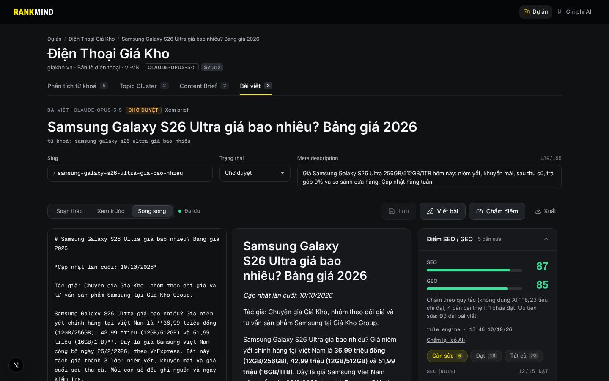
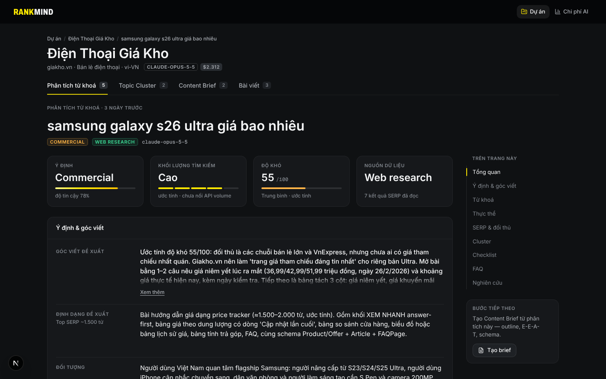
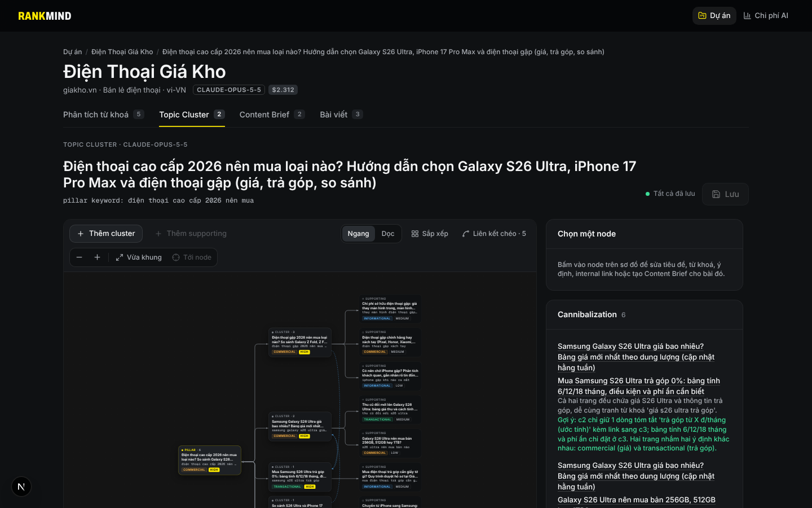

# RankMind

**AI SEO & GEO Content Studio** — từ một từ khoá đến bài viết sẵn sàng xuất bản, được AI tìm kiếm trích dẫn.

RankMind dùng Claude để phân tích ý định tìm kiếm, dựng topic cluster, viết content brief, soạn bài và chấm điểm theo bộ tiêu chuẩn **SEO/GEO 2026**: Generative Engine Optimization, E-E-A-T, nội dung RAG-ready, thực thể và knowledge graph, đa định dạng.



| Phân tích từ khoá | Topic cluster |
| --- | --- |
|  |  |

## Tính năng

| Bước | RankMind làm gì |
| --- | --- |
| **Phân tích từ khoá** | Ý định tìm kiếm, đối tượng, góc viết, từ khoá mở rộng (kể cả câu hỏi kiểu prompt AI), thực thể, phân tích SERP bằng web search, checklist GEO |
| **Topic cluster** | Pillar → cluster → supporting trên sơ đồ kéo thả; internal link; cảnh báo cannibalization |
| **Content brief** | Outline answer-first, tín hiệu E-E-A-T, kế hoạch schema, đa định dạng, FAQ; xuất Markdown |
| **AI Writer** | Viết bài streaming theo brief, sửa theo tiêu chí, viết lại; lưu phiên bản; JSON-LD tự sinh |
| **SEO/GEO Score** | 23 tiêu chí rule-based (không tốn token) + 8 tiêu chí do Claude chấm; sửa 1 click |
| **Chi phí AI** | Ghi token và chi phí từng lần gọi, theo dự án và theo tính năng |

## Bắt đầu nhanh

Yêu cầu: Node.js 22, PostgreSQL 16 (Docker hoặc Supabase), một Anthropic API key.

```bash
git clone https://github.com/giangduong-gk/seo rankmind && cd rankmind
docker run -d --name rankmind-db -p 5432:5432 \
  -e POSTGRES_USER=seo -e POSTGRES_PASSWORD=seo -e POSTGRES_DB=seo_dev postgres:16
npm run setup          # cài phụ thuộc cho apps/web, tạo apps/web/.env từ mẫu
# điền ANTHROPIC_API_KEY vào apps/web/.env
npm run db:migrate     # tạo schema `seo` (RLS bật sẵn)
npm run db:seed        # (tuỳ chọn) dự án demo
npm run dev            # http://localhost:3000
```

Hướng dẫn đầy đủ: [docs/getting-started.md](docs/getting-started.md).

## Cấu trúc repo

```
.
├── apps/
│   └── web/                 Ứng dụng Next.js 15 (UI + server actions + API routes)
│       ├── src/app/         Route: dự án, phân tích, cluster, brief, bài viết, chi phí AI
│       ├── src/components/  UI kit (AiDoIt Design System), shell, editor cluster/bài viết
│       ├── src/lib/         Pipeline AI (Claude), scorer, JSON-LD, Prisma client
│       ├── prisma/          Schema, migration, seed, script nhập dữ liệu
│       ├── prompts/         Bộ tiêu chuẩn SEO/GEO 2026 (system prompt, được cache)
│       ├── scripts/         Công cụ dev: lint token màu, báo cáo UX
│       └── tests/           Vitest (unit) + Playwright (e2e, a11y, UX gates)
├── docs/                    Tài liệu kỹ thuật và sản phẩm (xem docs/README.md)
├── .github/workflows/       CI: typecheck · unit · build · token lint · e2e
└── package.json             Lệnh tiện ích ở gốc (chuyển tiếp vào apps/web)
```

## Lệnh thường dùng

| Lệnh (chạy ở gốc repo) | Tác dụng |
| --- | --- |
| `npm run dev` | Server phát triển tại `localhost:3000` |
| `npm run build` | Build production |
| `npm run check` | Typecheck + unit test + token lint (chạy trước khi commit) |
| `npm run test:e2e` | Playwright e2e + UX gates (cần Postgres có database `seo_test`) |
| `npm run db:migrate` | Áp migration lên `DATABASE_URL` |
| `npm run db:seed` | Nạp dữ liệu demo |

## Tài liệu

- [Mục lục tài liệu](docs/README.md)
- [Kiến trúc hệ thống](docs/architecture.md) · [Pipeline AI](docs/ai-pipeline.md) · [Cơ sở dữ liệu](docs/database.md)
- [Triển khai (Vercel + Supabase)](docs/deployment.md) · [Kiểm thử](docs/testing.md) · [Design system](docs/design-system.md)
- [Kế hoạch sản phẩm](docs/product/product-plan.md) · [Quyết định kiến trúc (ADR)](docs/decisions/)
- [Đóng góp](CONTRIBUTING.md) · [Bảo mật](SECURITY.md) · [Nhật ký thay đổi](CHANGELOG.md)

## Công nghệ

Next.js 15 (App Router, React 19) · TypeScript · Anthropic SDK (Claude Opus/Sonnet 5.5) · Prisma · PostgreSQL / Supabase · React Flow · Zod · Vitest · Playwright · AiDoIt Design System.
